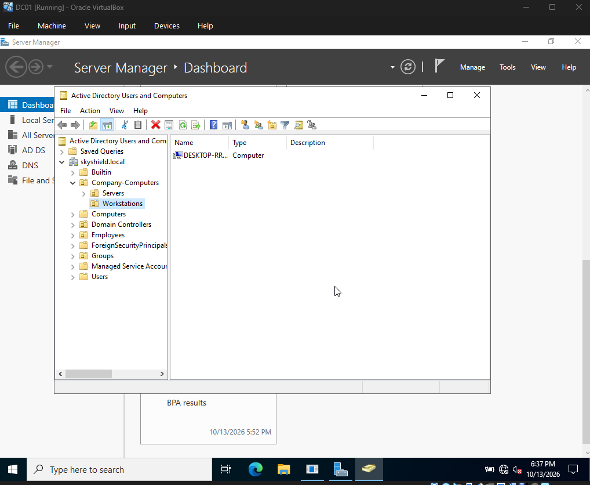
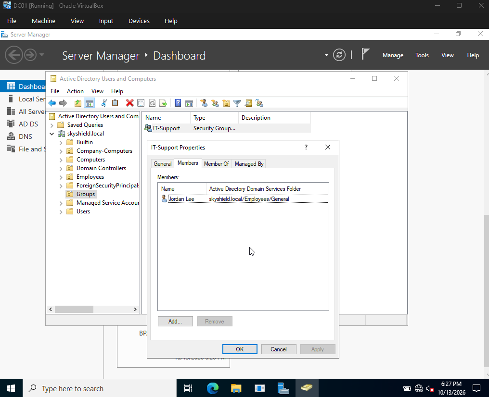
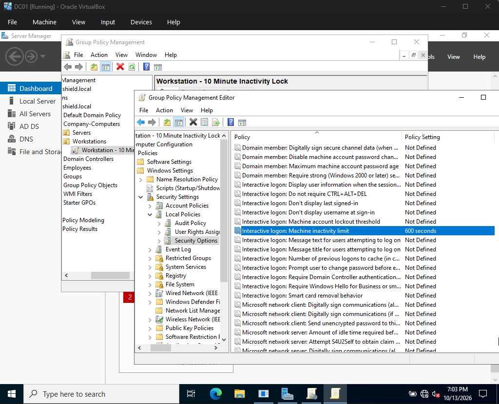
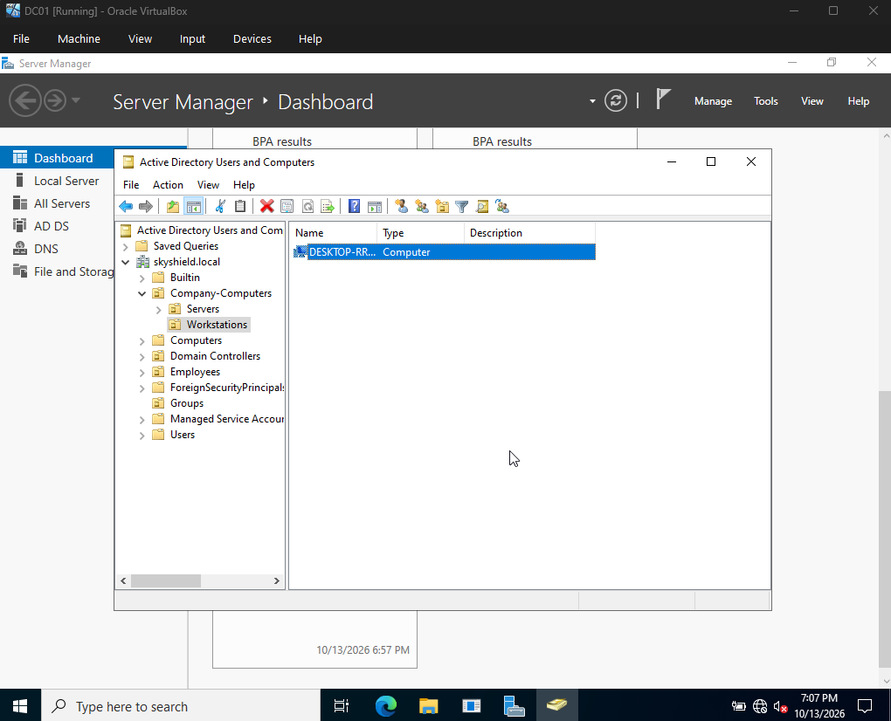
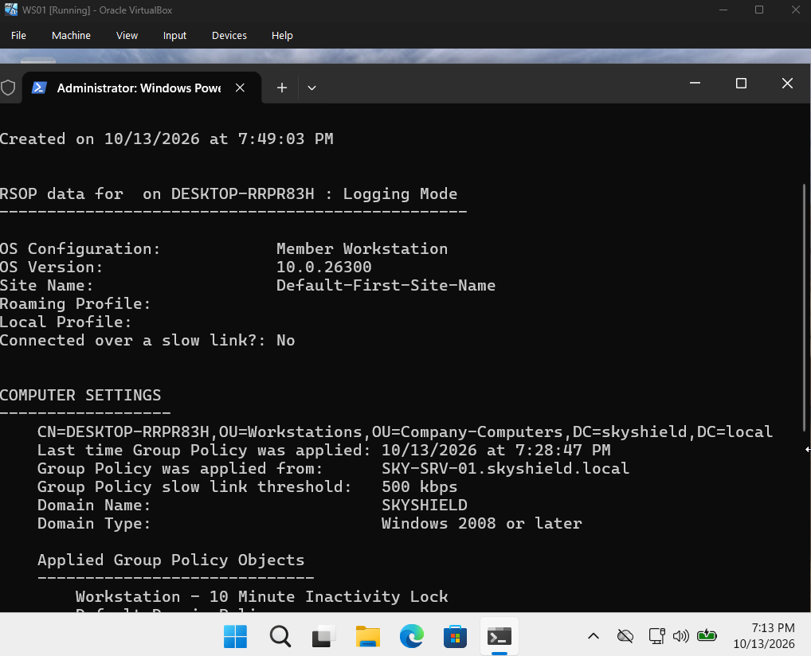
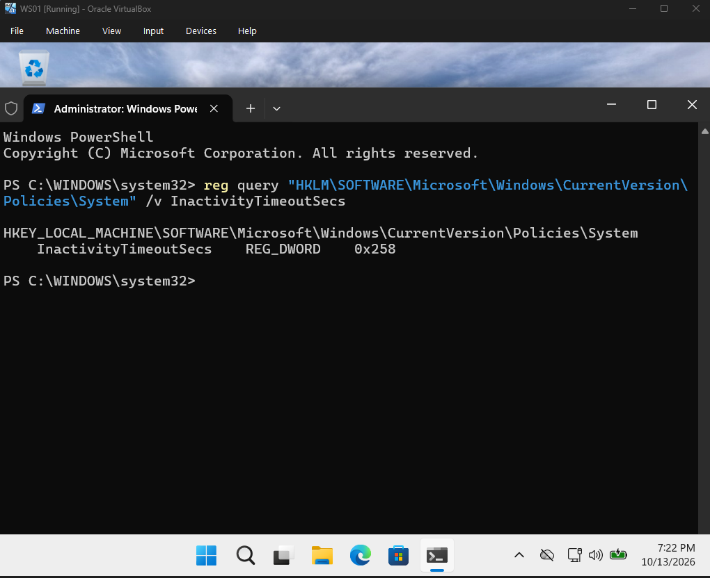
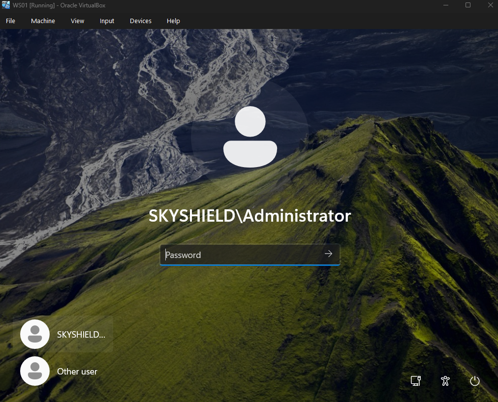

# Active Directory & Group Policy Administration Lab

## Overview

This project demonstrates hands-on IT administration using Windows Server, Active Directory Domain Services (AD DS), Group Policy, and Windows 11 in a VirtualBox environment.

I created an Active Directory domain, organized users and computers into Organizational Units (OUs), configured a security group, joined a Windows 11 workstation to the domain, and implemented and tested a Group Policy Object (GPO) that locks the workstation after 10 minutes of inactivity.

## Objectives

- Configure Active Directory Domain Services.
- Create and organize Organizational Units.
- Create domain user accounts and security groups.
- Configure private virtual networking and DNS.
- Join a Windows 11 workstation to an Active Directory domain.
- Configure and apply a workstation inactivity-lock policy.
- Validate policy application and workstation behavior.

## Lab Environment

| Component | Configuration |
|---|---|
| Virtualization | Oracle VirtualBox |
| Server | Windows Server Evaluation |
| Client | Windows 11 Enterprise Evaluation |
| Domain | `skyshield.local` |
| Domain Controller | `SKY-SRV-01` |
| Workstation | `WS01` |
| Internal Network | `skyshield-int` |
| Domain Controller IP (internal) | `192.168.50.10` |
| Workstation IP (internal) | `192.168.50.20` |

## Implementation

### 1. Active Directory Structure

Created an Active Directory domain and organized objects into the following OUs:

- `Employees`
  - `IT`
  - `Management`
  - `General`
- `Company-Computers`
  - `Workstations`
  - `Servers`
- `Groups`

### 2. User and Group Management

Created the domain user `jlee` and the security group `IT-Support`. Added the user to the group to demonstrate centralized account and group membership management.

### 3. Virtual Networking and Domain Join

Configured an internal VirtualBox network named `skyshield-int` for communication between the domain controller and Windows 11 workstation.

Configured private IP addresses, verified connectivity, checked domain DNS resolution, and joined WS01 to `skyshield.local`.

### 4. Group Policy Configuration

Created and linked the `Workstation - 10 Minute Inactivity Lock` GPO to the `Workstations` OU.

Configured the security option:

`Interactive logon: Machine inactivity limit`

The configured value was 600 seconds (10 minutes).

### 5. Validation and Testing

Validated the implementation by:

- Testing connectivity between WS01 and the domain controller.
- Resolving `skyshield.local` through DNS.
- Refreshing computer policy with `gpupdate`.
- Confirming the custom GPO appeared in `gpresult`.
- Verifying `InactivityTimeoutSecs` was set to `0x258` (600 seconds).
- Allowing the workstation to remain idle and confirming that the session locked.

## Skills Demonstrated

- Windows Server administration
- Active Directory Domain Services
- User and security group management
- Organizational Unit administration
- DNS and network troubleshooting
- Windows domain joining
- Group Policy configuration
- Registry-based verification
- Security policy testing and documentation

## Screenshots and Validation

### 1. Active Directory Structure
Shows the organizational units created to organize employees, computers, and security groups.

### 2. Domain User and Security Group
Shows the domain user and IT-Support security group configuration.

### 3. Group Policy Configuration
Shows the configured inactivity-lock security policy set to 600 seconds.

### 4. Workstation Organizational Unit
Shows the WS01 computer account placed in the Workstations OU so the intended policy can apply.

### 5. Applied Group Policy
Shows the workstation's applied Group Policy results, including the custom inactivity-lock GPO.

### 6. Registry Verification
Shows the registry value `InactivityTimeoutSecs` set to `0x258`, equivalent to 600 seconds.

### 7. Inactivity-Lock Test
Shows the workstation locking after the configured period of inactivity.

## Lessons Learned

This project reinforced the importance of DNS configuration, network connectivity, OU placement, and Group Policy scope in Windows domain administration. It also demonstrated the importance of validating security configurations on the client rather than relying only on the settings configured on the server.

## Disclaimer

This is an educational lab using virtual machines and evaluation operating systems. It is not a production environment.
